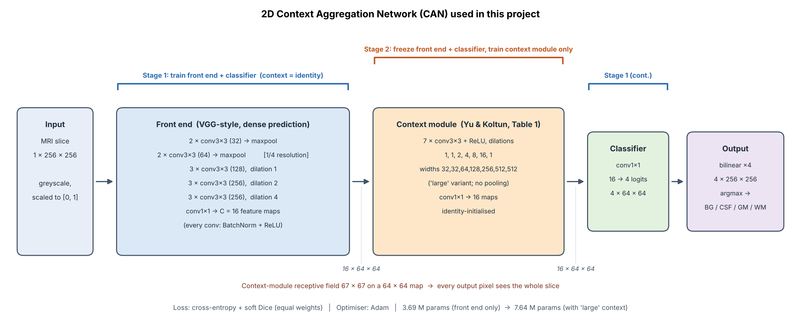
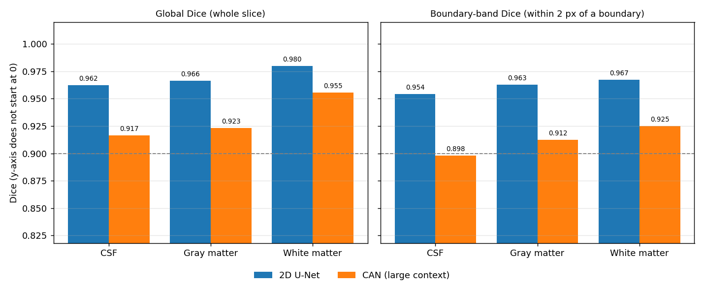
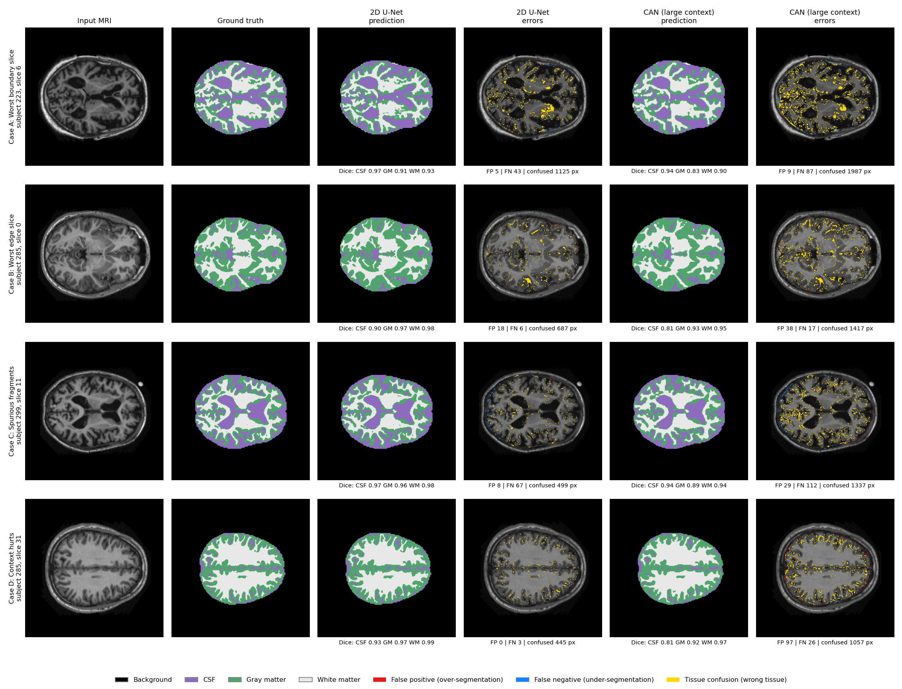
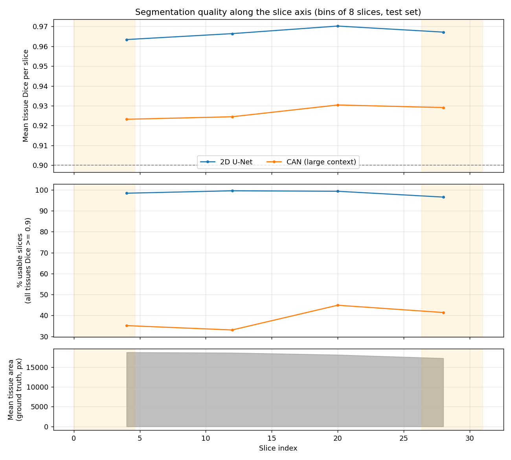

# 2D-CAN MODEL ON BRAIN TISSUE SEGMENTATION

## Model Description 
### The problem
Manually contouring brain tissue on MRI is slow, and an annotation assistant that proposes contours for an imaging specialist to review and adjust could save clinical time. This project segments 2D axial brain MRI slices from the OASIS dataset into four classes: background, cerebrospinal fluid (CSF), gray matter (GM) and white matter (WM). This is a dense, per-pixel classification problem. The hard part is not the large tissue interiors but the boundaries between them. RF coil intensity inhomogeneity, partial volume effects and fine gyral folds mean that a high global Dice score can hide local boundary errors and disconnected anatomical regions. The project implements a 2D Context Aggregation Network (CAN) and asks whether its multi-scale context genuinely improves boundary quality over a standard 2D U-Net baseline, and whether the extra compute is justified.

### How it works
CAN is designed for dense prediction: it grows the receptive field with *dilated* convolutions instead of pooling, so spatial resolution is not thrown away. The implementation `modules.py` has three parts:  
1. A VGG-style **front end** with BatchNorm and two max-pools, so a 256 × 256 slice becomes 16 feature maps of 64 × 64; the later convolutions use dilation 2 and 4 in place of the removed poolings. It is trained from scratch, and removes three poolings rather than the paper's<sup>[1]</sup> two, to keep a finer 1/4 resolution for thin CSF and cortical structures.  
2. The **context module** from Table 1 of the paper: seven 3 × 3 convolutions with dilations 1, 1, 2, 4, 8, 16, 1 and a final 1 × 1 convolution, with no pooling. Its 67 × 67 receptive field is larger than the 64 × 64 feature map, so every output pixel can use information from the whole slice. It is initialised as an identity mapping (Eq. 4 / 5 of the paper) so it starts as a pass-through.
3. A 1 × 1 **classifier** produces four class logits, which are bilinearly upsampled back to 256 × 256. Training follows the paper's two-stage recipe. In stage 1 the front end and classifier are trained alone (context module = identity). In stage 2 the context module (the "large" variant) is added on top of the stage-1 weights, the front end and classifier are frozen, and only the context module is trained. The loss is cross-entropy plus soft Dice, optimised with Adam. The baseline is a standard 4-level 2D U-Net (31.0 M parameters) with skip connections.


| File | Purpose |
|---|---|
| `dataset.py` | Image–mask pairing and integrity checks, subject-level split, preprocessing, `Dataset` / `DataLoader` |
| `modules.py` | `UNet2D` (baseline), `CAN2D` (`FrontEnd`, `ContextModule`), `build_model` |
| `utils.py` | Cross-entropy + soft Dice loss, confusion-based per-class Dice / IoU |
| `train.py` | Training, validation, testing and profiling; saves checkpoint, curves and `results_<run>.json` |
| `predict.py` | Loads saved weights, runs inference on the test split, prints the benchmark and runs the boundary / slice-position / failure-case analysis |

## Feasibility Review  
### 1. User Need, Scope & Acceptance Criteria
The project chosen proposes an annotation assistant that generates brain tissue segmentation contours. The intended user is an imaging specialist, who reviews and adjusts the contours provided by the model. The purpose of implementing this model is to cut down on clinical contouring time. The central engineering dilemma is that high global dice scores can conceal local boundary errors and disconnected anatomical regions. To investigate this, acceptability criteria are a target dice score of >= 0.90 across all tissue labels on the held-out test set, reporting per class dice and intersection over union, inspecting difficult boundaries and measuring peak GPU memory usage and per case inference time. These were chosen as it provides key insight into the model’s ability to produce valid segmentations on edge cases, with respect to the metric of time and computing resources which it is intending to reduce from current system expectations.  
  
### 2. Model Choice & Course Concepts
The proposed dataset configuration is the OASIS Brain 2D dataset. The model architecture chosen is the 2D CAN architecture from the easy difficulty band. This was chosen as the CAN model is specifically designed for dense prediction<sup>[1]</sup>, which is quite applicable to the medical segmentation problem space. It will be compared to a baseline U-Net for analysis of its performance. This is supported by the class content in contact seven, on segmentation in convolutional neural networks. It specifically references the applicability in medical imaging and provides a valuable resource for architecture and features of the model to consider for this problem space.  
  
### 3. Preliminary Feasibility evidence  
An initial dataset audit will verify image-mask alignment, label consistency, file integrity and the number of usable subjects and slices. A small pilot experiment will test data loading, model output dimensions, loss calculation and training stability. GPU memory usage and iteration time will be recorded to estimate training costs. These checks will establish whether the dataset, architecture and hardware are compatible before committing to full training.  
  
### 4. Risks, budget & fallback  
Key technical risks for the brief are fine gyral folds in the data, partial volume effects at boundaries and RF coil intensity inhomogeneity. Managing these challenges in the scope of the computing budget will be a high priority for development. The computing budget available is either the UQ EAIT Rangpur GPU cluster, or a personal home computer with one NVIDIA 3060ti GPU. The next planned experiment is smaller scale testing on the CAN model architecture to ensure validity for the project. The fallback is to the 2D improved U-Net architecture. 

## Dependencies Required
| Package | Version used | Needed for |
|---|---|---|
| Python | 3.11.9 | everything |
| PyTorch | 2.5.1+cu121 (2.1 or newer is needed for the GFLOP counter; if it is missing, `train.py` skips the count and carries on) | models, training, inference |
| NumPy | 1.26.4 | `dataset.py`, `predict.py` (not used in `modules.py`) |
| Pillow | 9.5.0 (9.1 or newer, for `Image.Resampling`) | image loading and resizing |
| Matplotlib | 3.7.1 | training curves and analysis figures |

**Hardware:** Models were trained on a NVIDIA GEFORCE 3060ti GPU with CUDA version 13.3 

**Dataset layout.** The course-provided PNG export of OASIS must sit next to `train.py` as `keras_png_slices_data/`, containing `keras_png_slices_{train,validate,test}` and `keras_png_slices_seg_{train,validate,test}`.

**Reproducibility.**
- Seed 42 is used for Python's `random`, `torch.manual_seed` and the NumPy generator that shuffles subjects, so the subject-level split is identical on every run. `train.py` and `predict.py` both call the same `load_data()`, so every model is evaluated on the same test slices in the same order.
- The test set is never used to choose a checkpoint. The best epoch is picked by validation mean foreground Dice, and the learning-rate scheduler watches validation loss.
- Output files are named per run (`best_<run>.pth`, `results_<run>.json`, `training_curves_<run>.png`), so runs never overwrite each other.
- `predict.py` recomputes the test Dice from the saved checkpoint and checks it against `results_<run>.json`, which catches a mismatched split or checkpoint.
- Not bit-for-bit reproducible on GPU: `torch.backends.cudnn.deterministic` is not set, so re-runs should land close to, but not exactly on, the reported numbers. Timings and memory depend on the hardware.

## Usage, Example Inputs and Outputs

```bash
# 1. Baseline
python train.py --model unet
# 2. CAN stage 1: front end + classifier only (context module = identity)
python train.py --model can --context none
# 3. CAN stage 2: add the context module on the stage-1 weights, train only the context module
python train.py --model can --context large --lr 1e-4 --epochs 20 --init-from best_can_none.pth --freeze-frontend
# 4. Benchmark and failure analysis (baseline first, model under test last)
python predict.py --models unet2d can_large
```
**Input:** an 8-bit greyscale 256 × 256 axial slice (`case_<subject>_slice_<n>.nii.png`), loaded as a float tensor of shape `(1, 256, 256)` scaled to [0, 1].
**Output:** logits of shape `(4, 256, 256)`; the arg-max is a label map with 0 = background, 1 = CSF, 2 = GM, 3 = WM.


## Data Investigation
**Preprocessing Conducted:**
  1. *Pairing and integrity checks* (`create_image_mask_pairs`). Filenames are parsed by regex into (subject ID, slice ID). Duplicate files, images with no mask and masks with no image all raise an error, so image–mask alignment is guaranteed by construction.
  2. *Greyscale conversion and resize* to a fixed 256 × 256. Bilinear interpolation is used for the MRI image and nearest-neighbour for the mask, so discrete labels are never blended.
  3. *Intensity normalisation:* pixel values are divided by 255, giving [0, 1]. This is a fixed scaling of the 8-bit PNG export, so train, validation and test slices are treated identically. There is no bias-field correction, so RF inhomogeneity is left for the network to cope with.
  4. *Mask encoding:* grey levels 0 / 85 / 170 / 255 are mapped to class indices 0 / 1 / 2 / 3 (background, CSF, GM, WM). The one-hot multi-channel encoding is done inside the Dice loss (`F.one_hot`); cross-entropy uses the integer labels directly.
  5. *Augmentation:* flips and ±7° rotations (applied identically to image and mask) are implemented but **disabled for every run** (`augment=False`), because it has not been established that, for example, horizontal flips preserve anatomical validity. All reported results are therefore without augmentation.
**Training, Validation and Test Splits:**

  | Split | Share of subjects | Role |
  |---|---|---|
  | Training | 70 % | Fits the weights |
  | Validation | 15 % | Selects the best checkpoint (mean foreground Dice) and drives the LR scheduler |
  | Test | 15 % | Used once per model after training, for all reported numbers and all error analysis |

**Subject and slice counts:**
- Total subjects: 354
- Training subjects: 247
- Validation Subjects: 53
- Test Subjects: 54
- Training slices: 7904
- Validation Slices: 1696
- Test Slices: 1728

  *Justification.* (i) The split is **by subject**, not by slice. Neighbouring slices of one brain are near-duplicates, so a slice-level split would leak the test set into training and inflate Dice. Disjointness of the three subject sets is asserted in code. (ii) The three course-provided partitions are pooled and re-split with a seeded shuffle so the ratio is explicit and one reproducible split is applied to every model. (iii) 15 % each for validation and test leaves enough subjects to select checkpoints and to compute per-class and per-slice statistics, while keeping 70 % for fitting. (iv) The baseline and the CAN use the identical split, which satisfies the "identical evaluation splits" requirement

## Open Research Dilemma

**The question (from the brief):** does multi-scale context (CAN) genuinely remove the boundary errors that a global Dice score hides, compared with a standard 2D baseline, or does it only smooth the easy slices at a higher compute cost?

**Short answer from these experiments:** no. The CAN with large context meets the Dice ≥ 0.90 target on every tissue label globally (0.917–0.955), but the plain 2D U-Net is better on every class, on both global and boundary-band Dice. The context module itself adds only +0.0016 mean Dice over the CAN front end alone, for roughly double the parameters and FLOPs. This project covers the brain (OASIS) variant of the dilemma and 2D models only; 3D volumetric models were not evaluated.

### Quantitative Benchmarking
Both models are scored on the same held-out test split. Dice and IoU are pooled over the whole test set (true / false positives and negatives are accumulated before the ratio is taken, so slices where a class is absent do not create NaNs). Background is left out of the tables (Dice ≈ 0.999 for every CAN model). **Boundary-band Dice** is the same Dice computed only on pixels within 2 px of a ground-truth boundary, so it measures boundary precision rather than interior agreement.

| Model (test split) | CSF Dice | GM Dice | WM Dice | **Mean Dice (fg)** | CSF IoU | GM IoU | WM IoU | Mean IoU (fg) |
|---|---|---|---|---|---|---|---|---|
| 2D U-Net (baseline) | 0.962 | 0.966 | 0.980 | **0.969** | 0.927† | 0.934† | 0.961† | 0.941† |
| CAN, front end only (stage 1) | 0.914 | 0.923 | 0.954 | **0.930** | 0.842 | 0.856 | 0.911 | 0.870 |
| CAN, large context (model under test) | 0.917 | 0.923 | 0.955 | **0.932** | 0.846 | 0.858 | 0.915 | 0.873 |

† The U-Net's Dice values are the 3-decimal bar labels in `global_vs_boundary_dice.png`, and its IoU is derived from them (IoU = Dice / (2 − Dice) for pooled counts), so these carry about ±0.001 rounding error. 

| Class | U-Net global | U-Net boundary band | Drop | CAN global | CAN boundary band | Drop |
|---|---|---|---|---|---|---|
| CSF | 0.962 | 0.954 | −0.008 | 0.917 | **0.898** | −0.019 |
| Gray matter | 0.966 | 0.963 | −0.003 | 0.923 | 0.912 | −0.011 |
| White matter | 0.980 | 0.967 | −0.013 | 0.955 | 0.925 | −0.030 |



- **Target met globally, missed at the boundary.** The CAN clears 0.90 on all three tissues globally, but its CSF boundary-band Dice is 0.898. This is the situation the brief warns about: an acceptable global score concealing a local failure.
- **The baseline wins everywhere.** The U-Net leads by 4.5 pp (CSF), 4.3 pp (GM) and 2.5 pp (WM), about 3.8 pp on the mean.
- **The CAN loses more at boundaries.** Its drop from global to boundary-band Dice is 0.011–0.030, about 2–3 times the U-Net's 0.003–0.013.
- **The context module adds almost nothing.** Over the front end alone it gives +0.0022 (CSF), +0.0008 (GM), +0.0018 (WM), +0.0016 mean Dice and +0.0028 mean IoU. That is under 1/20 of the gap to the U-Net. Each model was trained once (one seed), so differences this small cannot be separated from run-to-run noise.
- **Different fit behaviour.** The U-Net's training loss falls to about 0.021 while its validation loss turns upward after epochs 5–8 (minimum ≈ 0.076, ending ≈ 0.099); validation Dice plateaus at about 0.963, and the checkpoint is chosen on Dice. The CAN does not overfit in the same way: its training loss stalls at 0.097 (front end) and 0.094 (with context), far above the U-Net's, so it is limited by capacity or resolution. In stage 2 the validation Dice moves only from 0.9255 to 0.9274 over 20 epochs.

### Resource Profiling Table

| Model | Parameters (trainable) | GFLOPs / slice | Inference latency (ms / slice) | Peak VRAM, inference | Peak VRAM, training | Training time |
|---|---|---|---|---|---|---|
| 2D U-Net (baseline) | 31.04 M (31.04 M)‡ | 96.2‡ | 8.54 | not recorded | 3,241 MB | 129.4 min |
| CAN, front end only | 3.69 M (3.69 M) | 32.7 | 2.82 | 156 MB | 1,063 MB | 51.1 min |
| CAN, large context | 7.64 M (3.95 M) | 65.0 | 4.93 | 247 MB | 658 MB | 34.2 min (stage 2 only; 85.3 min for both stages) |

Latency is the forward pass only (batch size 8, data loading excluded, first batch discarded as warm-up, CUDA-synchronised). Peak VRAM is `torch.cuda.max_memory_allocated`, i.e. what PyTorch's allocator used, which is lower than what `nvidia-smi` shows. Training peak includes weights, gradients, optimiser state and activations. Stage 2 peaks lower than stage 1 because the frozen front end needs no gradients, optimiser state or stored activations. Both stages take about 1.7 min per epoch.

What the table shows:
- **The context module is not cheap relative to what it adds:** versus the front end alone, large context costs 2.07× the parameters, 1.99× the FLOPs, 1.75× the latency and 1.58× the inference VRAM, for +0.0016 mean Dice. This is well under the "5–10×" overhead the brief anticipates, but there is still essentially nothing to show for it.
- **The CAN is smaller than the U-Net:** 4.1× fewer parameters and 1.5× fewer FLOPs than the baseline. In absolute terms its cost is small (about 5 ms and 250 MB per slice at inference), but so is the accuracy it delivers.

### Qualitative Error Autopsies
Four failure cases were chosen automatically by `predict.py`, each for a different reason so they tell different stories (the five worst slices would mostly be neighbours from one subject). A fifth category, "context helps" (a slice where the CAN beats the U-Net by more than 0.01 mean tissue Dice), found **no qualifying slice**. In the figure, yellow marks tissue confusion (wrong tissue), red marks false positives and blue marks false negatives.



| Case | Selected because | Subject, slice | U-Net Dice (CSF / GM / WM) | CAN Dice (CSF / GM / WM) | Errors in px, FP / FN / confused: U-Net → CAN |
|---|---|---|---|---|---|
| A | Lowest boundary-band Dice (CAN) | 223, slice 6 | 0.97 / 0.91 / 0.93 | 0.94 / **0.83** / 0.90 | 5 / 43 / 1,125 → 9 / 87 / 1,987 |
| B | Worst of the outer 15 % of slices | 285, slice 0 | 0.90 / 0.97 / 0.98 | **0.81** / 0.93 / 0.95 | 18 / 6 / 687 → 38 / 17 / 1,417 |
| C | Most extra disconnected pieces (CAN) | 299, slice 11 | 0.97 / 0.96 / 0.98 | 0.94 / **0.89** / 0.94 | 8 / 67 / 499 → 29 / 112 / 1,337 |
| D | Largest CAN drop vs U-Net | 285, slice 31 | 0.93 / 0.97 / 0.99 | **0.81** / 0.92 / 0.97 | 0 / 3 / 445 → 97 / 26 / 1,057 |

- **Case A, worst boundary slice (cortical GM/WM interface).** Tightly folded cortex with a thin gray-matter ribbon. The errors are almost all yellow, running along the cortical GM/WM interface and around the ventricles. This is the hardest slice for *both* models (the U-Net's largest confusion count, 1,125 px, and GM Dice 0.91), so the trigger is intrinsic: partial volume on a ribbon only a few pixels wide. The CAN degrades further, with 1.8× the confused pixels and GM Dice 0.83.
- **Case B, worst edge slice (small CSF structures).** At slice 0, the ground truth holds only small, isolated CSF patches. The CAN labels most of them as neighbouring tissue (the error is yellow, not blue; only 17 px are false negatives) and CSF Dice falls to 0.81, against 0.90 for the U-Net. Failure mode: loss of small, isolated structures.
- **Case C, scattered fragments (sulcal CSF).** A brain with prominent sulci and large ventricles. Errors are many small, isolated clusters across the cortex rather than one blob, which is what the "extra disconnected pieces" criterion detects. The CAN has more false positives (29 vs 8) and false negatives (112 vs 67), and GM Dice 0.89. Failure mode: no spatial consistency at fine scale.
- **Case D, where context hurts (thin CSF strips at the other end of the stack).** Same subject as case B, opposite end. CSF Dice is 0.81 against 0.93 for the U-Net, and 97 background pixels are labelled as tissue (U-Net: 0). Two of the four cases coming from one subject (285) suggests a subject-level effect, such as anatomy or acquisition, that deserves checking.

**Cross-cutting findings.**
1. In all four cases the errors are dominated by tissue-versus-tissue confusion (445–1,987 px per slice), not by tissue-versus-background errors (mostly under 100 px). The outline of the brain is accurate. The CSF / GM / WM interfaces are the problem.
2. The CAN is worse than the U-Net on the same slices, and no slice exists where context helped by more than 0.01. The extra context does not repair these failures.
3. CSF is the CAN's weakest class (0.81 in both B and D).
4. *Likely root cause (hypothesis, not tested by ablation):* the network predicts on a 64 × 64 grid and bilinearly upsamples the logits, so structures 1–3 px wide cannot be placed precisely. Global context helps decide *what* a large region is, not *where* a 2 px boundary lies, so a bigger receptive field does not address a resolution limit. The flat stage-2 training curves fit this: the frozen front end limits what the context module can recover.



**Slice position.** A slice counts as "usable" when every tissue class on it reaches Dice ≥ 0.90 (a strict per-slice test). Reading the plot (approximate, ±2–3 %; exact values are in the *Usability* table that `predict.py` prints): the U-Net has about 97–100 % usable slices in every 8-slice bin. The CAN has about 33–35 % in slices 0–15, 45 % in slices 16–23 and 41 % in slices 24–31, so it is weakest towards the low-index end. Mean tissue Dice is nearly flat along the stack (CAN ≈ 0.923–0.930, U-Net ≈ 0.963–0.970), and ground-truth tissue area varies little (≈ 17–19 k px). Unlike the prostate base and apex, these OASIS slices contain no region where the anatomy vanishes, so the failures here are fine-structure failures that occur at every height, not slice-transition failures.

**Cases that remain unsuitable for automated drafting.**
- Slices with thin or small CSF structures (sulcal CSF, interhemispheric strips, the end slices). The CAN drops to CSF Dice ≈ 0.81 there, and even the U-Net reaches only 0.90 at slice 0.
- The cortical GM/WM interface in highly folded cortex (case A): even the best model reaches only about 0.91 GM / 0.93 WM.
- With the CAN, only roughly a third to a half of slices pass the 0.90-everywhere test, so most of its drafts would need substantive correction. With the U-Net the large majority pass, but the two anatomies above still need specialist review.

### Actionable Engineering Recommendation
**Recommendation for the project manager: build the annotation assistant on the plain 2D U-Net, and do not fund the CAN context module.**

| Option | Mean Dice (fg) | Worst boundary-band Dice | Usable slices (approx.) | Params | GFLOPs / slice | Verdict |
|---|---|---|---|---|---|---|
| 2D U-Net | **0.969** | 0.954 | ≈ 97–100 % | 31.0 M | 96.2 | **Recommended**: best on every class and metric |
| CAN, front end only | 0.930 | not measured | not measured | 3.7 M | 32.7 | Cheapest, but 3.9 pp below the U-Net |
| CAN, large context | 0.932 | 0.898 (CSF) | ≈ 33–45 % | 7.6 M | 65.0 | Dominated: +0.16 pp for about 2× the cost, and below target at CSF boundaries |

- **Where spatial context delivers measurable gain:** nowhere that matters. The gain is under 0.3 pp per class, is spread evenly across classes and slices, and no slice improves by more than 0.01 Dice.
- **Where it breaks down:** thin or small CSF structures and the cortical GM/WM interface, which are exactly the boundaries a specialist spends time correcting.
- **Compute is not the constraint here.** The CAN-large costs about 5 ms and 250 MB per slice, and the U-Net's FLOPs are only 1.5× higher, so the U-Net's accuracy advantage should not need a bigger compute budget. This is not yet measured for the U-Net: confirm it against the hardware named in the feasibility review once its latency and VRAM are filled into the profiling table.
- **Deploy with a human in the loop.** Flag slices for mandatory review when the predicted mask has extra disconnected fragments or very small CSF area; these are the signatures of cases B, C and D.
- **If more investment is wanted, in order of cost:** (1) repeat both models over several seeds to put error bars on the comparison; (2) enable and validate augmentation, since the U-Net's validation loss already shows overfitting; (3) try a lighter U-Net (`base_channels=32`, already supported in `modules.py`) to see whether cost can drop with little accuracy loss; (4) if the CAN is to be pursued, test the resolution hypothesis by removing one more pooling (1/2 resolution) and fine-tuning the whole network jointly rather than freezing the front end.

**Limitations.** Each model was trained once on one split. Pooled Dice weights large slices more than small ones, and the 2 px boundary band and the 0.90-everywhere "usable" test are our own definitions. The CAN is a scaled-down, from-scratch version (front-end width 32, 16 context channels, 1/4 resolution), so conclusions apply to this implementation and not to the paper's pretrained VGG-16 front end. No bias-field correction or augmentation was used. 3D models were not evaluated, so this recommendation covers multi-scale dilation only, not 3D volumetric context.  
  
## References  
1. F. Yu and V. Koltun, “Multi-scale context aggregation by dilated convolutions,” in Proc. ICLR, 2016


## Artificial Intelligence Usage Disclosure
An AI model was used in predict.py, specifically lines 398 to 522. Claude AI was used on 6/11/26 with this prompt:
> Hi Claude, I need help using matplotlib for generating figures of relevant results for a machine learning assignment. Can you please review my code and provide code for plotting figures? I'm specifically looking for ones that plot failure cases, slice positions and global dice vs boundary dice

The code was audited, verified and empirically tested by first line by line inspection, then inspection of the produced results against the known figures

An AI model was used in predict.py, specifically lines to 394. Claude AI was used on 6/11/26 with this prompt:  
> Hi Claude, I need some help with creating a python file that analyses some machine learning models. Here is the code I have written for returning the relevant metrics. Can you please create some code that outputs the results of these to the console with print() in a user friendly way?  
  
The code was audited, verified and empirically tested by line by line inspection, then inspection of the produced results against the known figures (from my first attempt at console output).

An AI model was used to draft this README.md, including its prose, tables and the architecture figure `figures/can_architecture.png` (generated with a matplotlib script). Claude AI was used on 6/11/26 with this prompt:
> Hi Claude, I'm on the final stage of a Machine Learning assignment, writing the README.md report. Here is what I have written so far: Can you please correct formatting, double check all logic is consistent, and generate a figure for the CAN network workflow?

This was used as an improvement to formatting and language and was checked line by line to ensure no errors were present.
 
